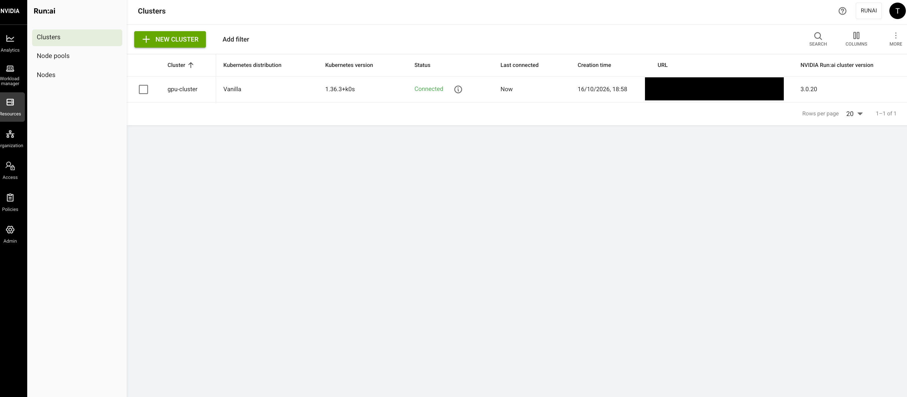
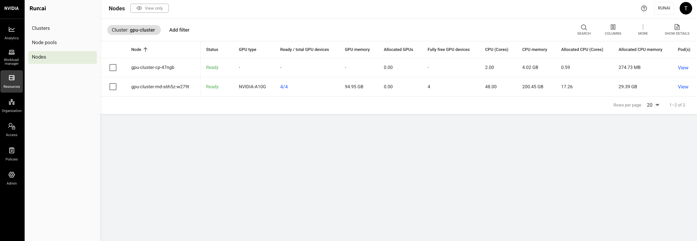
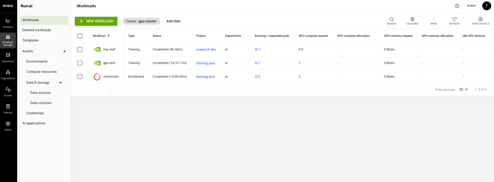

# NVIDIA Run:ai 3.0 (Open Source) on gpu-cluster, via the k0rdent catalog

Record of how open-source NVIDIA Run:ai **3.0.20** was installed on the k0rdent child cluster `gpu-cluster`, following the k0rdent catalog **`runai-cp`** instructions as closely as possible: <https://catalog.k0rdent.io/latest/apps/runai-cp/?dtab=install>

Done on 2026-10-16 (GPU stack upgrade 2026-10-20). Working files are in `~/runai-catalog/` on the management node.

> **Sanitized public copy.** Account-, DNS- and cluster-specific values are replaced with placeholders: `<AWS_ACCOUNT_ID>`, `<RUNAI_ZONE_ID>`, `<PARENT_ZONE_ID>`, `<ROUTE53_CHANGE_ID>`, `<CLUSTER_UID>`, `<ELB_HOSTNAME>`, `<ELB_IP_1>`/`<ELB_IP_2>`, `<K0RDENT_ADMIN_IAM_USER>`, `<ADMIN_PASSWORD>`. The domain is shown as `lab.example.com` / `runai.lab.example.com`; the DNS IAM user and its policy as `runai-dns-user` / `runai-dns-route53-policy`. Substitute your own values. Timestamps, versions, command output and node names are kept as recorded.

## Status

| Item | State |
|------|-------|
| Run:ai **control plane** | Running on gpu-cluster, namespace `runai-backend` (30 pods), deployed by k0rdent |
| Run:ai **cluster** component | Running on gpu-cluster, namespace `runai` (29 pods), **Connected** to the control plane |
| URL | **https://runai.lab.example.com**, Let's Encrypt certificate (issuer `YR1`), valid until 2027-01-14 |
| First login | `test@run.ai` (catalog default username) with the password set in `tenantsManager.config.adminPassword` (`<ADMIN_PASSWORD>`). Pick a strong password, and change it in the UI after first login |
| Fractional GPUs | **Working, with GPU-memory enforcement** (since 2026-10-20, §10). A `--gpu-portion-request 0.5` job sees 11514 MiB of the A10G |
| Last change | 2026-10-20 16:52 UTC: GPU stack upgraded for fractions (§10). gpu-cluster now runs k0s **v1.36.3+k0s.2** / containerd 2.3.3, GPU Operator 26.7.2, driver 615.71.09; `runai-cluster` Helm revision 3 (`nvFractions.set=true`) |

## Screenshots (Run:ai UI, 2026-10-20)

Taken after the GPU stack upgrade (§10). The browser bar and the cluster URL are redacted.

**Clusters:** `gpu-cluster` Connected, Kubernetes 1.36.3+k0s, Run:ai cluster 3.0.20



**Nodes:** both nodes Ready; the GPU node has 4/4 NVIDIA A10G



**Workloads:** `frac-half` (0.5 GPU, fractional), `gpu-test` (1 GPU) and `mnist-train` (distributed PyTorch, 2 pods) all completed



## What runs where

```
Management cluster (k0rdent, namespace kcm-system): configuration only, no Run:ai workloads
├── ServiceTemplates: runai-control-plane-3-0-20, external-dns-1-19-0, cert-manager-1-18-2,
│                     kube-prometheus-stack-90-0-0, knative-operator-1-23-1, ingress-nginx-4-12-1,
│                     cert-manager-aws-secret, letsencrypt-prod-clusterissuer
├── ConfigMap runai-control-plane          Run:ai values (domain, admin, ingress annotation)
├── Secret service-external-dns-values     external-dns values + AWS keys
├── Secret cert-manager-aws-secret         wraps prod-route53-credentials-secret (AWS keys)
├── ConfigMap letsencrypt-prod-clusterissuer
├── MultiClusterService runai-prereqs       → ingress-nginx
└── MultiClusterService runai-control-plane → external-dns, Route53 secret, ClusterIssuer,
                                              prometheus, knative-operator, runai-backend
                     │  (k0rdent/Sveltos deploys to clusters labeled group=runai-cp)
                     ▼
gpu-cluster (k0rdent child, labels group=runai-cp, workload-type=ml-training)
├── runai-backend      Run:ai CONTROL PLANE (Helm release runai-backend, chart control-plane 3.0.20), via k0rdent
├── runai              Run:ai CLUSTER (Helm release runai-cluster, chart runai-cluster 3.0.20), via Helm (wizard command)
├── ingress-nginx      load balancer <ELB_HOSTNAME>
├── external-dns       creates runai.lab.example.com in Route53
├── cert-manager       1.17.2 (owned by MCS ml-platform, see option B) + ClusterIssuer letsencrypt-prod
├── monitoring         kube-prometheus-stack 90.0.0 (Grafana off)
├── knative-operator   1.23.1 (operator only; Knative Serving not configured)
├── gpu-operator       26.7.2, driver 615.71.09, toolkit 1.20.1, device plugin 0.20.1 (ClusterDeployment serviceSpec, §10)
├── kube-system        + node-inotify-sysctl DaemonSet, + calico-anp-compat RBAC (§10 fixes)
└── nodes (k0s v1.36.3+k0s.2, containerd 2.3.3; management cluster itself stays on v1.35.4+k0s):
           gpu-cluster-cp-47ngb (t3.medium, control plane, upgraded in place)
           gpu-cluster-md-s6h5z-w279t (g5.12xlarge, 4× A10G, labels runai-system + runai-gpu-worker; replaced md-m4wqc-62b9w on 2026-10-20)
```

## Decisions and how this differs from the catalog

| Topic | Catalog `runai-cp` | What we did | Why |
|-------|--------------------|-------------|-----|
| Run:ai version | Mirantis wrapper chart `runai-control-plane` 0.3.0 = **Run:ai 2.23** (catalog `charts.yaml`: `appVersion: 2.23.0`) | NVIDIA **open-source 3.0.20** `control-plane` chart | 2.23 needs a license and Mirantis registry access (chart returned 404 without login); 3.0 is Apache 2.0 |
| Chart source | `oci://registry.mirantis.com/k0rdent-enterprise-catalog` | kgst with `repo.spec.url=https://helm.ngc.nvidia.com/nvidia/runai-oss`, `repo.spec.type=default` | Run:ai 3.0 isn't in any k0rdent catalog registry. The URL is NVIDIA's official one (their Helm docs and `runai-installer` source) |
| License | `license:` in the ConfigMap | Not used (kept as a comment) | Open source has no license |
| `clusterIssuer:` | In the ConfigMap; the 2.23 **wrapper** creates the issuer | Same fields, as a separate manifest (`4b-…`) | Neither NVIDIA's 2.23 nor 3.0 chart creates a ClusterIssuer (checked `control-plane` 2.23.85 and 3.0.20) |
| `control-plane:` nesting | `control-plane.global.…` | `global.…` at the top level | NVIDIA's chart is used directly (no wrapper); nested values would be silently ignored |
| `knative.domain` | In the ConfigMap | Commented out | Wrapper-only; Knative Serving not set up yet |
| GPU Operator | 25.10.0 + k0s values ConfigMap | **26.7.2** + driver **615.71.09** (since 2026-10-20; was 25.3.0) | Run:ai 3.0 fractions need GPU Operator ≥ 26.7.1 (toolkit ≥ 1.20.1, device plugin ≥ 0.20.1) and driver r615+. Required k0s 1.36 for containerd 2.x first (§10) |
| ingress-nginx | 4.13.2 inside the Run:ai MCS | 4.12.1 (existing ServiceTemplate) in its own MCS `runai-prereqs` | Already registered; separate MCS can be removed on its own |
| cert-manager | 1.18.2 inside the Run:ai MCS | **Option B:** reuse existing 1.17.2 (owned by MCS `ml-platform`) | User choice; avoids cleaning up the stuck `ml-platform` MCS now |
| kube-prometheus-stack | 77.0.0, values `grafana:` at top level | 90.0.0, values nested under `kube-prometheus-stack:` | Run:ai 3.0 needs 88.6.5+. The catalog chart wraps upstream, so top-level values are ignored |
| knative-operator | 1.19.0 | 1.23.1 | Run:ai 3.0 supports Knative Serving 1.21–1.23 |
| external-dns values | top level | nested under `external-dns:`, plus `domainFilters`, `txtOwnerId`, `policy: upsert-only` | The chart wraps upstream; stay inside our zone and never delete records |
| Cluster template | Example Cilium ClusterTemplate (new cluster) | Existing gpu-cluster (Calico) | No spare NAT gateway in us-east-1a for a new cluster |
| k0rdent version | 1.4.0+ | 1.3.2 | The kgst + MCS flow works on 1.3.2; the 1.4 requirement is for the wrapper chart |
| Run:ai cluster component | Not covered (done by hand from the UI) | Same: Helm command from the UI wizard | Strict catalog; the `runai-cluster` ServiceTemplate was registered, then removed again |

---

## 1. Preflight (gpu-cluster)

| Check | Result |
|-------|--------|
| Kubernetes | v1.35.1+k0s (Run:ai 3.0 supports 1.35–1.37) |
| Default StorageClass | `ebs-csi-default-sc` (EBS; RWO only, fine for a PoC per the catalog) |
| Nodes | control plane t3.medium (2 CPU/4 GB); worker g5.12xlarge (48 CPU / 187 GiB / 4 GPUs) |
| GPU stack | GPU Operator 25.3.0, driver 570, containerd 1.7.30, so fractional GPUs are placement only |
| Time-slicing | Already off (`devicePlugin.config` empty; 4 GPUs, not 16) |
| Tools on this node | `jq`, `openssl`, `tmux`, Helm 3.22 |

## 2. Prerequisites

### 2.1 ingress-nginx (Management cluster)

```bash
export KUBECONFIG=~/.kube/config
kubectl apply -f ~/runai-prereqs-mcs.yaml     # MCS runai-prereqs → ingress-nginx-4-12-1, selector workload-type=ml-training
```

Result:
- IngressClass `nginx` exists.
- AWS ELB `<ELB_HOSTNAME>` (IPs <ELB_IP_1>, <ELB_IP_2>).

### 2.2 Remove the standalone KAI Scheduler from Lab 5.3 (gpu-cluster)

Run:ai 3.0 ships its own KAI Scheduler, and the Lab 5.3 release (v0.14.0) owned PriorityClasses `build`/`inference`/`train`, which the `runai-cluster` chart also creates.

Backup: `~/k0rdent-backups/gpu-cluster-kai-20261016T201400Z/` (queues, config, shard, PriorityClasses, Helm values).

```bash
export KUBECONFIG=~/gpu-cluster.kubeconfig
helm uninstall kai-scheduler -n kai-scheduler
kubectl delete namespace kai-scheduler kai-resource-reservation
kubectl get crd -o name | grep -E 'scheduling\.run\.ai|kai\.scheduler' | xargs -r kubectl delete
kubectl delete priorityclass kai-build kai-inference kai-train
```

Removed:
- the release
- the 2 namespaces
- 6 CRDs, including the 6 Lab 5.3 queues
- 4 webhooks
- 18 ClusterRoles/Bindings
- 6 PriorityClasses

The GPU Operator was unaffected (still 4 GPUs).

### 2.3 Labels

```bash
# Management cluster: the catalog's MCS selector
kubectl --kubeconfig ~/.kube/config label clusterdeployment gpu-cluster -n kcm-system group=runai-cp
# gpu-cluster: the catalog's node labels (there's no CPU worker in this cluster)
kubectl --kubeconfig ~/gpu-cluster.kubeconfig label node gpu-cluster-md-m4wqc-62b9w \
  node-role.kubernetes.io/runai-system=true node-role.kubernetes.io/runai-gpu-worker=true
```

Both were set with kubectl and aren't persistent: re-applying `~/gpu-cluster-deployment.yaml` drops the CD label, and a replaced node loses its labels.

### 2.4 DNS zone and IAM user (AWS, done from the Mac)

Full commands, the parent-zone review and undo steps are in `~/k0rdent-backups/runai-route53-iam-runbook.md` **on the Mac**.

| Item | Value |
|------|-------|
| Hosted zone | `lab.example.com`, ID `<RUNAI_ZONE_ID>` (account <AWS_ACCOUNT_ID>) |
| Delegation | NS record in shared parent `example.com` (`<PARENT_ZONE_ID>`), change `<ROUTE53_CHANGE_ID>` (INSYNC); exactly 1 record added (`CREATE`), snapshot taken first |
| Name servers | ns-348.awsdns-43.com, ns-1746.awsdns-26.co.uk, ns-627.awsdns-14.net, ns-1326.awsdns-37.org |
| IAM user | `runai-dns-user`, policy `runai-dns-route53-policy`: change/list records **only** in this zone, plus GetChange and zone listing. `<K0RDENT_ADMIN_IAM_USER>` (AdministratorAccess) was deliberately not used |
| Key file | Mac `~/k0rdent-backups/iam-runai-dns-user-key.json` (mode 600) |
| Parent CAA | `example.com` allows only `letsencrypt.org`, which applies to the subzone and matches our issuer |

---

## 3. Catalog step 1: install ServiceTemplates (Management cluster)

```bash
export KUBECONFIG=~/.kube/config
KG=oci://ghcr.io/k0rdent/catalog/charts/kgst
OSS="--set repo.name=runai-oss --set repo.spec.url=https://helm.ngc.nvidia.com/nvidia/runai-oss --set repo.spec.type=default"

# Run:ai control plane 3.0.20 (NVIDIA open source) → runai-control-plane-3-0-20
helm upgrade -i runai-control-plane-st $KG -n kcm-system --set chart=control-plane:3.0.20 --set prefix=runai- $OSS
# Catalog prerequisites
helm upgrade --install external-dns          $KG -n kcm-system --set chart=external-dns:1.19.0
helm upgrade --install cert-manager          $KG -n kcm-system --set chart=cert-manager:1.18.2
helm upgrade -i        kube-prometheus-stack $KG -n kcm-system --set chart=kube-prometheus-stack:90.0.0
helm upgrade -i        knative-operator      $KG -n kcm-system --set chart=knative-operator:1.23.1
# ingress-nginx-4-12-1 and gpu-operator-25-3-0 were already registered
```

Notes:
- **kgst only creates templates.** It creates a ServiceTemplate plus a HelmRepository; nothing is deployed until an MCS or ClusterDeployment references the template.
- **Shared HelmRepository.** The `runai-oss` HelmRepository is shared and created by a Helm hook with `resource-policy: keep`.
- **cert-manager was an upgrade.** The `cert-manager` kgst release already existed for 1.17.2, so this upgraded it. Template `cert-manager-1-17-2` is kept, and `ml-platform` still references it.

## 4. Catalog step 2: verify

```bash
kubectl get servicetemplates -A
# runai-control-plane-3-0-20, external-dns-1-19-0, cert-manager-1-18-2, kube-prometheus-stack-90-0-0,
# knative-operator-1-23-1, ingress-nginx-4-12-1, gpu-operator-25-3-0, …: all VALID true
```

## 5. Catalog step 4 "Deploy service" (`~/runai-catalog/`)

| # | Catalog item | File | Applied by |
|---|--------------|------|------------|
| 1 | Run:ai config | `1-runai-config-configmap.yaml` | Claude |
| 2 | NVIDIA Operator config | — (already in the gpu-cluster ClusterDeployment serviceSpec) | — |
| 3 | External-DNS AWS secret | `3-external-dns-aws-secret.yaml` (**contains AWS keys**) | User (keys), re-applied by Claude after removing `extraArgs` |
| 4 | Cert-Manager AWS secret + ServiceTemplate | `4-cert-manager-aws-secret.yaml` (**contains AWS keys**) | User |
| 4b | (catalog `clusterIssuer:` block) | `4b-letsencrypt-clusterissuer.yaml` | Claude |
| 5 | MultiClusterService | `5-multiclusterservice.yaml` | Claude |

```bash
export KUBECONFIG=~/.kube/config
cd ~/runai-catalog
kubectl apply -f 1-runai-config-configmap.yaml
kubectl apply -f 3-external-dns-aws-secret.yaml -f 4-cert-manager-aws-secret.yaml
kubectl apply -f 4b-letsencrypt-clusterissuer.yaml
kubectl apply -f 5-multiclusterservice.yaml
```

### 5.1 Run:ai config: active values

```yaml
global:
  domain: runai.lab.example.com
  ingress:
    extraAnnotations:
      cert-manager.io/cluster-issuer: letsencrypt-prod
tenantsManager:
  config:
    adminUsername: "test@run.ai"   # It is highly recommended to change this
    adminPassword: "<ADMIN_PASSWORD>"      # set a strong password (the catalog example uses a published default)
```
- **Wrapper-only lines:** the catalog's `license:`, `clusterIssuer:`, `control-plane:` and `knative:` lines are kept as comments in the file.
- **Checked against the chart:** every active key was checked against NVIDIA's 3.0.20 `values.yaml`, and `extraAnnotations` with a local `helm template`.
- **What tenants-manager does with it:** it creates the tenant `runai` and the first admin user (in Keycloak) from `tenantsManager.config`, on first install only.

### 5.2 ClusterIssuer (catalog `clusterIssuer:` fields)

```yaml
kind: ClusterIssuer
metadata: { name: letsencrypt-prod }
spec:
  acme:
    server: https://acme-v02.api.letsencrypt.org/directory
    privateKeySecretRef: { name: letsencrypt-prod }
    solvers:
      - dns01:
          route53:
            region: us-east-1
            accessKeyIDSecretRef:     { name: prod-route53-credentials-secret, key: AccessKeyID }
            secretAccessKeySecretRef: { name: prod-route53-credentials-secret, key: SecretAccessKey }
```

It's delivered as a ConfigMap plus a ServiceTemplate (`resources.localSourceRef`, `deploymentType: Remote`), the same pattern as the catalog's Cert-Manager AWS secret. `prod-route53-credentials-secret` lands in namespace `cert-manager` on gpu-cluster.

### 5.3 MultiClusterService `runai-control-plane`

| Service | Namespace | Template | Values |
|---------|-----------|----------|--------|
| external-dns | external-dns | external-dns-1-19-0 | Secret `service-external-dns-values` |
| prod-route53-credentials-secret | cert-manager | cert-manager-aws-secret | — |
| letsencrypt-prod | cert-manager | letsencrypt-prod-clusterissuer | — |
| prometheus | monitoring | kube-prometheus-stack-90-0-0 | `kube-prometheus-stack.grafana.enabled: false` |
| knative-operator | knative-operator | knative-operator-1-23-1 | — |
| runai-backend | runai-backend | runai-control-plane-3-0-20 | ConfigMap `runai-control-plane` |

Selector: `group: runai-cp`. Backups of earlier versions: `5-multiclusterservice.yaml.bak-before-runai` and `~/k0rdent-backups/mcs-runai-control-plane-20261016T223753Z.yaml`.

## 6. Issue found and fixed: EBS volumes couldn't be created on the g5 node

**Symptom:** `runai-backend` Postgres, NATS and Thanos PVCs stuck Pending:
```
failed to provision volume with StorageClass "ebs-csi-default-sc": error generating accessibility requirements:
no topology key found on CSINode gpu-cluster-md-m4wqc-62b9w
```

**Cause:**
- The g5's CSINode had `drivers: []`. The EBS CSI node plugin had registered once, on 2026-10-13, and lost its registration, most likely when the kubelet/containerd restarted on 2026-10-14 for the NVIDIA runtime.
- Nothing had used EBS on that node before (the cluster had zero PVs), so it went unnoticed.

**Fix:** restart the node plugin. The DaemonSet recreates it and it re-registers.
```bash
export KUBECONFIG=~/gpu-cluster.kubeconfig
kubectl delete pod -n kube-system -l app=ebs-csi-node --field-selector spec.nodeName=gpu-cluster-md-m4wqc-62b9w
kubectl get csinode gpu-cluster-md-m4wqc-62b9w -o jsonpath='{.spec.drivers[*].name}'   # ebs.csi.aws.com
```

Result: all 3 PVCs Bound (Postgres 8Gi, NATS 3Gi, Thanos 100Gi), and the control plane came up (30/30 pods). The k0rdent service briefly showed `Failed` while volumes were pending, then `Deployed` on its own.

## 7. Run:ai cluster component (after the catalog, from the UI wizard)

1. Log in at https://runai.lab.example.com. The onboarding wizard opens: cluster `gpu-cluster`, location **Same as the control plane**.
2. The wizard generates a `helm upgrade -i runai-cluster …` command with a bootstrap token (valid 2 h) and cluster UID `<CLUSTER_UID>`.
3. The command as generated failed with **403 Forbidden**, and needed these fixes:

| Wizard | Used | Why |
|--------|------|-----|
| Helm repo `runai` = `https://helm.ngc.nvidia.com/nvidia/runai` | `…/nvidia/runai-oss` | The paid (Support-Entitled) repo needs an NGC key, hence the 403 |
| `--version="2.26.50"` | `3.0.20` | 2.26.50 doesn't exist in the open-source repo (only 3.0.15/17/19/20); must match the control plane |
| `ingressClass=haproxy` | `nginx` | gpu-cluster runs ingress-nginx |
| — | `clusterConfig.global.subdomainSupport=false` | Path-based workspace URLs; no wildcard DNS or certificate |
| URL, token, UID, `global.fipsMode=off` | unchanged | — |

The script, with the token removed (pass it as `BOOTSTRAP_TOKEN`), is `~/runai-catalog/6-runai-cluster-helm-install.sh`:
```bash
helm repo add runai https://helm.ngc.nvidia.com/nvidia/runai-oss --force-update
helm upgrade -i runai-cluster runai/runai-cluster -n runai \
--set controlPlane.url=runai.lab.example.com \
--set controlPlane.bootstrapToken="${BOOTSTRAP_TOKEN}" \
--set cluster.uid=<CLUSTER_UID> \
--set cluster.url=https://runai.lab.example.com --version="3.0.20" --create-namespace \
--set clusterConfig.global.ingress.ingressClass=nginx \
--set clusterConfig.global.subdomainSupport=false \
--set global.fipsMode=off
```

Why the UI can't install it itself:
- The control plane holds no cluster-admin credentials for the target cluster.
- The design is that the cluster connects out to the control plane, never the other way round.

## 8. Verification (2026-10-16 ~23:08 UTC)

| Check | Result |
|-------|--------|
| `runai-backend` pods | 30/30 Running; k0rdent service `Deployed`; MCS `runai-control-plane` 1/1 |
| `runai` pods | 29/29 Running; RunaiConfig Reconciled/DependenciesFulfilled/Deployed/**Available** |
| Scheduler | `runai-scheduler-default` 1/1 (Run:ai's own KAI); default department, node pool and queue created |
| Control plane link | cluster-sync: "Sync events successfully", "Updated node pool default successfully" |
| DNS | external-dns created `runai.lab.example.com` A/AAAA records (+ TXT ownership records) |
| TLS | Certificate `runai-backend-tls` Ready, issued by `letsencrypt-prod`, Let's Encrypt `YR1`, until 2027-01-14 |
| HTTPS | `curl https://runai.lab.example.com/` → 200, certificate verification OK |
| GPUs | 4 on gpu-cluster-md-m4wqc-62b9w |

Useful checks:
```bash
export KUBECONFIG=~/gpu-cluster.kubeconfig
kubectl get pods -n runai-backend; kubectl get pods -n runai
kubectl get runaiconfig runai -n runai
kubectl get certificate -n runai-backend; kubectl get clusterissuer letsencrypt-prod
kubectl logs -n external-dns deploy/external-dns --tail=20
kubectl --kubeconfig ~/.kube/config get multiclusterservice runai-control-plane runai-prereqs
```

## 9. Issue found and fixed: UI didn't show the cluster as connected (2026-10-17)

> **Superseded on 2026-10-20 by §10.** The GPU stack was upgraded and `nvFractions.set=true` was re-enabled; the cluster stays connected *and* fractions work. §9 remains the diagnosis and the fallback for clusters that can't meet the GPU-stack requirements.

**Symptom:** after §7 the cluster pods were all Running, but the UI didn't show `gpu-cluster` as connected.

**Investigation:**
1. **The cluster side was healthy.** RunaiConfig was Available, and cluster-sync logged "Sync events successfully".
2. **The control plane's DB showed the cluster alive** (`last_liveness` updating every few seconds) but a **required dependency failing**:
   ```bash
   export KUBECONFIG=~/gpu-cluster.kubeconfig
   kubectl exec -n runai-backend runai-backend-postgresql-0 -- sh -c 'PGPASSWORD="$(cat "$POSTGRES_POSTGRES_PASSWORD_FILE")" psql -U postgres -d backend -Atc \
     "select now()-last_liveness, status->'"'"'dependencies'"'"'->'"'"'required'"'"'->'"'"'gpu-stack'"'"'->>'"'"'available'"'"' from cluster_service.clusters where name='"'"'gpu-cluster'"'"'"'
   ```
   ```
   dependencies.required.gpu-stack.available = false
     gpu-fractioning: "NVIDIA container toolkit version v1.17.5-ubuntu20.04 from ClusterPolicy spec.toolkit.version
                       is below minimum supported version v1.20.1"   (reason GPUOperandVersionUnsupported)
   ```
3. **Why it's checked:** `runai-cluster` enables memory-enforced GPU fractions by default (`kai-resource-management.kai-scheduler.global.nvFractions.set: true`). That installs the **gpu-fractioning** subchart, and its `GpuFractioningConfig/default` reports `Ready=False` on GPU Operator 25.3.0's toolkit (v1.17.5).
4. **NVIDIA's operator code** (`go-operator/pkg/controller-utils/gpu_fractioning_checker.go`) treats `gpu-stack` as available when that `GpuFractioningConfig` **doesn't exist**.

**Red herring:** probing the API with a guessed client ID (`runai-cli`) returned 502. identity-manager panics with a nil pointer on unknown OAuth clients (a Run:ai bug), but that was caused by the probe and isn't related to this problem.

**Fix:**

Step 1: Helm upgrade with GPU fractioning turned off. The bootstrap token from the wizard had expired by then. The hooks skip the control-plane call when neither a bootstrap token nor a client secret is set (`helm-hooks-handler/internal/hooks/cluster_hook.go`), and the agent keeps its own credentials, so the token is cleared:
```bash
export KUBECONFIG=~/gpu-cluster.kubeconfig
helm upgrade runai-cluster runai/runai-cluster -n runai --version 3.0.20 --reuse-values \
  --set controlPlane.bootstrapToken="" \
  --set kai-resource-management.kai-scheduler.global.nvFractions.set=false
# → revision 2. Removes the gpu-fractioning Deployment, ServiceAccounts and RBAC. Rollback: helm rollback runai-cluster 1
```

Step 2: remove the orphaned `GpuFractioningConfig`. Helm created it as a **post-install hook**, so it isn't tracked and the upgrade left it behind. Its finalizer (`gpu-fractioning.nvidia.com/cleanup-node-conditions`) could no longer be processed because the controller was gone. Before removing it, I checked that the nodes had no fractioning conditions, labels or taints, so there was nothing for the finalizer to clean. Its two DaemonSets (`gpu-fractioning-fractiond`, `gpu-fractioning-mpsd`, 0 pods) are owned by it and were garbage-collected.
```bash
kubectl get gpufractioningconfigs.gpu-fractioning.kai.scheduler default -o yaml \
  > ~/k0rdent-backups/gpu-cluster-gpufractioningconfig-default-20261017T043950Z.yaml
kubectl delete gpufractioningconfigs.gpu-fractioning.kai.scheduler default --wait=false
kubectl patch gpufractioningconfigs.gpu-fractioning.kai.scheduler default --type=merge -p '{"metadata":{"finalizers":null}}'
```

**Result (04:40 UTC):**
- `gpu-stack` available (nvidia and gpu-fractioning both available), `prometheus` available, and the cluster's last heartbeat was 7 s earlier.
- All `runai` pods Running.
- `runai-scheduler-default`, `binder` and `admission` are up.

**What remains, by design:**
- KAI's `kai-config` still shows `gpuSharingMode: NvFractions` and `DependenciesFulfilled=False ("GpuFractioningConfig not found")`. Run:ai 3.0 hard-codes this (`go-operator/.../kai-operator/resources/global.go`: "Deliberately not configurable: a node that cannot run CUDA-native fractions keeps the workload Pending rather than falling back to the unenforced legacy ones").
- So on the original GPU stack, **fractional GPU requests stayed Pending**. Whole GPUs, quotas, gang scheduling and preemption worked. (Fixed by the upgrade in §10.)
- Enabling fractions needs GPU Operator ≥ 26.7.1 (toolkit ≥ 1.20.1), driver r615+ and containerd 2.0+, then `nvFractions.set=true` again.

**Reinstall script:** `~/runai-catalog/6-runai-cluster-helm-install.sh` now includes `--set kai-resource-management.kai-scheduler.global.nvFractions.set=false` (previous version: `.bak-rev1`).

## 10. GPU stack upgrade for memory-enforced fractional GPUs (2026-10-20)

**Why:** with Run:ai 3.0, fractions only work with **gpu-fractioning** (NRI plugin + CUDA MPS), and there is no fallback mode. On the original stack a `-g 0.5` / `--gpu-portion-request 0.5` job stayed Pending with:
```
no nodes with enough resources were found: 1 node is not ready for fractional GPU scheduling.
Condition gpu-fractioning.nvidia.com/Ready is Unknown. Reason: ConditionNotFound.
```

**Requirements** (from github.com/kai-scheduler/kai-gpu-fractioning README, "Prerequisites"), before and after:

| Requirement | Before | After | Delivered by |
|---|---|---|---|
| containerd **2.0+ with NRI** | 1.7.30 | **2.3.3**, NRI on by default (`/run/nri/nri.sock`) | k0s **v1.36.3+k0s.2**. Every k0s 1.35.x still bundles containerd 1.7 |
| GPU Operator **≥ 26.7.1** | 25.3.0 | **26.7.2** | ServiceTemplate `gpu-operator-26-7-2` (kgst) |
| Container toolkit **≥ 1.20.1** | 1.17.5 | **1.20.1** | GPU Operator 26.7.2 default |
| Device plugin **≥ 0.20.1** | 0.17.1 | **0.20.1** | GPU Operator 26.7.2 default |
| Driver **r615+** | 570.124.06 | **615.71.09** (CUDA 13.4) | `driver.version` override; r615 isn't the GPU Operator default |

Kubernetes 1.36 is within Run:ai 3.0's supported range (1.35–1.37). The **management cluster was not changed**: `ip-10-0-9-140` stays on k0s v1.35.4.

**Phase 0: backups and freeze.**
- Backups: `~/k0rdent-backups/gpu-stack-upgrade-20261020T130402Z/` (ClusterDeployment, K0sControlPlane, MachineDeployment, worker config, MCSs, Helm values, ClusterPolicy, PVCs/PVs, node labels, queues, projects).
- Deleted `frac-half` and `jupyter-dev`.

**Phase 1: k0s 1.35.1 → 1.36.3** (management cluster, gpu-cluster's ClusterDeployment):
```bash
export KUBECONFIG=~/.kube/config
P='{"spec":{"config":{"k0s":{"version":"v1.36.3+k0s.2"}}}}'
kubectl patch clusterdeployment gpu-cluster -n kcm-system --type merge -p "$P" --dry-run=server -o json | jq -c '{k0s: .spec.config.k0s, template: .spec.template, worker: .spec.config.worker}'
kubectl patch clusterdeployment gpu-cluster -n kcm-system --type merge -p "$P"
```

How it rolled out:
- **Control plane** (`K0sControlPlane`, `updateStrategy: InPlace`): upgraded in place through a k0s autopilot plan in about 2 minutes. The API stayed up; the node was briefly cordoned.
- **GPU worker** (`MachineDeployment`): **surge replacement**. A new g5.12xlarge (`gpu-cluster-md-s6h5z-w279t`) was created, then the old one (`md-m4wqc-62b9w`) was drained and deleted. The Run:ai control plane was offline while its pods moved.
- **Re-labeled** the new node: `node-role.kubernetes.io/runai-system=true`, `node-role.kubernetes.io/runai-gpu-worker=true` (see Known limitations, "Labels not persistent").

Problems hit (see Troubleshooting T10–T13):
1. **T10:** the first target, `v1.36.4+k0s.1`, isn't on the k0rdent Enterprise k0s mirror (404), so the worker never bootstrapped. Retargeted to `v1.36.3+k0s.2`.
2. **AWS `InsufficientInstanceCapacity`** for g5.12xlarge in us-east-1a for about 2.5 hours. CAPA retried by itself; the old node kept serving because of the surge-first rollout.
3. **T11:** inotify exhaustion on the new node (139 of 128 instances in use) stopped Calico felix, which broke pod networking there. Fixed with DaemonSet `node-inotify-sysctl`.
4. **T12:** a Calico RBAC mismatch after the k0s 1.36 manifests: a freshly started felix never became ready. Fixed with ClusterRole `calico-anp-compat`.
5. **T2/§6:** the new node's EBS CSI driver wasn't registered. Fixed by restarting that node's `ebs-csi-node` pod.
6. **T13:** `runai/cluster-api` crash-looped on `Failed to fetch oidc configuration … 502` while Keycloak was still starting. Fixed by restarting the pod once the control plane was up.

**Phase 2: GPU Operator 26.7.2 + driver 615.71.09** (management cluster):
```bash
helm upgrade -i gpu-operator-26-7-2 oci://ghcr.io/k0rdent/catalog/charts/kgst -n kcm-system --set chart=gpu-operator:26.7.2
# then JSON-patch gpu-cluster's ClusterDeployment, service index 0 (with "test" ops guarding name/template):
#   template gpu-operator-25-3-0 -> gpu-operator-26-7-2
#   values: + driver.version "615.71.09"; toolkit env unchanged (CONTAINERD_CONFIG=/etc/k0s/containerd.d/nvidia.toml,
#           CONTAINERD_SOCKET=/run/k0s/containerd.sock, CONTAINERD_RUNTIME_CLASS=nvidia)
```
- The resulting fields are in [`runai-catalog/gpu-cluster-clusterdeployment-changes.yaml`](runai-catalog/gpu-cluster-clusterdeployment-changes.yaml).
- **Rollout:** Sveltos upgraded the Helm release (rev 4). The 615 driver container built its kernel modules for `6.8.0-1050-aws` in about 3 minutes, then the toolkit, device plugin, DCGM and validators followed. ClusterPolicy reached `ready` at 16:49 UTC; 4× A10G allocatable, node labels `cuda.driver-version.full=615.71.09`, `cuda.runtime-version.full=13.4`.
- **k0s 1.36 containerd layout:** `/etc/k0s/containerd.toml` is a k0s-managed placeholder (`# k0s_managed=true`, `version = 3`) that **imports `/etc/k0s/containerd.d/*.toml`**. The toolkit's runtime config goes in `/etc/k0s/containerd.d/nvidia.toml`, so the existing toolkit env still worked. (k0s 1.35 used `/run/k0s/containerd-cri.toml`.)
- **NRI:** containerd 2.3's effective config has `[plugins.'io.containerd.nri.v1.nri'] disable = false`, and the socket is `/run/nri/nri.sock`. No change was needed.

**Phase 3: Run:ai GPU fractioning back on** (gpu-cluster):
```bash
export KUBECONFIG=~/gpu-cluster.kubeconfig
helm upgrade runai-cluster runai/runai-cluster -n runai --version 3.0.20 --reuse-values \
  --set controlPlane.bootstrapToken="" \
  --set kai-resource-management.kai-scheduler.global.nvFractions.set=true
# → revision 3
```

Result (16:52 UTC):
- `GpuFractioningConfig/default` Ready=True (`AllComponentsReady`: FractiondReady, MpsdReady).
- Node condition `gpu-fractioning.nvidia.com/Ready=True`, label `gpu-fractioning.kai.scheduler/nvidia-driver-version.major=615`.
- `kai-config` `DependenciesFulfilled=True`.
- Control plane `gpu-stack` available, heartbeat current.

**Verification: a half-GPU job** (example in "Next steps"). `frac-half` was Running about 20 s after submit, with `runai-allocated-gpus: 0.5`. Inside the container:
```
NVIDIA_GPU_MEMORY_LIMIT=11514 NVIDIA_GPU_MEMORY_REQUEST=11514
name, memory.total [MiB], memory.used [MiB]
NVIDIA A10G, 11514 MiB, 0 MiB          ← half of the A10G's ~23 GB, enforced
```

**Files added to the repo:**
- `runai-catalog/node-inotify-sysctl-ds.yaml`
- `runai-catalog/calico-anp-rbac-compat.yaml`
- `runai-catalog/gpu-cluster-clusterdeployment-changes.yaml`
- `runai-catalog/6-runai-cluster-helm-install.sh`, now with `nvFractions.set=true`

## Troubleshooting

All commands run on this management node. `G` = gpu-cluster, `M` = management cluster:
```bash
G() { kubectl --kubeconfig ~/gpu-cluster.kubeconfig "$@"; }
M() { kubectl --kubeconfig ~/.kube/config "$@"; }
# Read-only query against the Run:ai control-plane database (db "backend")
RUNAI_DB() { G exec -n runai-backend runai-backend-postgresql-0 -- sh -c \
  'PGPASSWORD="$(cat "$POSTGRES_POSTGRES_PASSWORD_FILE")" psql -U postgres -d backend -Atc "$1"' _ "$1"; }
```

### T1. UI doesn't show the cluster as connected, but all `runai` pods are Running

This happened on 2026-10-17 (fix in §9). How it was traced, one step at a time:

**Step 1: is the cluster side healthy?** If yes, the problem isn't installation.
```bash
G get pods -n runai --no-headers | grep -vcE 'Running|Completed'          # 0 = all pods fine
G get runaiconfig runai -n runai -o json | jq -r '.status.conditions[] | "\(.type)=\(.status)"'
#   Reconciled/DependenciesFulfilled/Deployed/Available all True = operator is happy
G logs -n runai deploy/cluster-sync --tail=20 | grep -E 'Sync events successfully|Updated node pool'
#   these lines = the cluster IS talking to the control plane
```
What we saw: all True, and sync lines every few seconds. So "can't connect" was not a network or auth problem.

**Step 2: what does the control plane think?** The UI reads the cluster record, so look at that directly.
```bash
RUNAI_DB "select name, version, now()-last_liveness as since_heartbeat from cluster_service.clusters"
RUNAI_DB "select jsonb_pretty(status->'dependencies'->'required') from cluster_service.clusters where name='gpu-cluster'"
```

| What you see | Meaning |
|---|---|
| `since_heartbeat` large or growing | Cluster really disconnected: check agent/cluster-sync logs and the control plane URL |
| `since_heartbeat` a few seconds **and** a required dependency `"available": false` | **Connected, but the UI shows a prerequisite problem.** This was our case |

What we saw:
```
since_heartbeat = 00:00:07
"gpu-stack": { "available": false,
  "components": { "nvidia": {"available": true},
                  "gpu-fractioning": {"available": false,
                     "reason": "NVIDIA container toolkit version v1.17.5-ubuntu20.04 from ClusterPolicy
                                spec.toolkit.version is below minimum supported version v1.20.1"} } }
```
The same status is visible on the cluster, without the DB:
```bash
G get cm runai-public -n runai -o jsonpath='{.data.runai-public}' | grep -A12 'gpu-stack:'
```

**Step 3: confirm it's GPU fractioning.**
```bash
G get gpufractioningconfigs.gpu-fractioning.kai.scheduler -A \
  -o custom-columns=NAME:.metadata.name,READY:'.status.conditions[?(@.type=="Ready")].status',REASON:'.status.conditions[?(@.type=="Ready")].reason'
#   default  False  GPUOperandVersionUnsupported   ← the culprit
G get configs.kai.scheduler kai-config -o json | jq -r '.status.conditions[] | "\(.type)=\(.status) \(.message)"'
#   DependenciesFulfilled=False "GPU-fractioning is missing Gpu Fractioning is not ready ... GPUOperandVersionUnsupported ..."
helm --kubeconfig ~/gpu-cluster.kubeconfig list -n gpu-operator      # gpu-operator-25.3.0 → toolkit v1.17.5
```

**Why this blocks the UI:** NVIDIA's source explains it.

| Source file (github.com/dsx-ai-factory/run-ai) | What it shows |
|---|---|
| `runai-cluster/cluster/go-operator/internal/run/operands/runai-public/resources/configmaps/runai_public.go` | `gpu-stack` is a **required** dependency; available = nvidia **and** gpu-fractioning |
| `runai-cluster/cluster/go-operator/pkg/controller-utils/gpu_fractioning_checker.go` | gpu-fractioning is available if `GpuFractioningConfig` **doesn't exist** or isn't Ready=False |
| `control-plane/frontend/src/utils/cluster.util/cluster.util.ts` | The UI renders the gpu-fractioning reason as the cluster's prerequisite problem |
| `runai-cluster/.../kai-scheduler/values.yaml` | `nvFractions.set` installs the gpu-fractioning subchart (`runai-cluster` sets it to `true`) |

**Fix:** §9. Turn off `nvFractions` and remove the leftover `GpuFractioningConfig` (Helm hook). Then step 2 shows `gpu-stack` available.

**Other required dependencies that would block the same way:**
- `gpu-stack.nvidia`: DCGM exporter / GPU Operator metrics missing
- `prometheus`: Prometheus operator, or the remote-write OAuth path

Use the same step-2 query to see which one fails, and read its `reason`.

### T2. Run:ai pods Pending: PVCs stuck, "no topology key found on CSINode"

Symptom: `runai-backend-postgresql-0`, `nats-0` and `thanos-receive-0` Pending; most other control-plane pods stuck in `Init`.
```bash
G get pvc -n runai-backend                                             # Pending
G get events -n runai-backend --field-selector involvedObject.kind=PersistentVolumeClaim | tail
#   ProvisioningFailed ... no topology key found on CSINode gpu-cluster-md-m4wqc-62b9w
G get csinode -o json | jq -c '.items[] | {node: .metadata.name, drivers: [.spec.drivers[]?.name]}'
#   the g5 node shows drivers: []   ← EBS CSI not registered with that node's kubelet
```
Fix: §6. Restart that node's `ebs-csi-node` pod. Re-check after any node or kubelet restart.

### T3. Wizard's `helm upgrade -i runai-cluster` fails with 403 Forbidden

```bash
helm repo list | grep runai
#   runai  https://helm.ngc.nvidia.com/nvidia/runai      ← paid (Support-Entitled) repo, needs an NGC key = 403
helm search repo runai/runai-cluster --versions | head -3   # open-source repo should list 3.0.x
```
Fix (§7):
- `helm repo add runai https://helm.ngc.nvidia.com/nvidia/runai-oss --force-update`
- use `--version 3.0.20`; the wizard suggested 2.26.50, which isn't in the open-source repo
- set ingress class `nginx`

### T4. `runai-cluster` upgrade or reinstall after the bootstrap token expired

The wizard token is valid for 2 hours. With `--reuse-values`, an expired token is reused by the Helm hooks. Pass `--set controlPlane.bootstrapToken=""`, and the hooks skip the control-plane call (`helm-hooks-handler/internal/hooks/cluster_hook.go`). For a **new** registration, generate a fresh command in the UI (Clusters).

### T5. API returns 502 Bad Gateway on `/api/v1/token`

Seen while probing with a guessed OAuth client ID (`runai-cli`). identity-manager **panics** on unknown clients (nil pointer in `KeycloakClientRepository.GetClientSecret`), and Traefik returns 502:
```bash
G logs -n runai-backend deploy/runai-backend-identity-manager --tail=200 | grep -E 'http: panic|GetClientSecret'
```
It's harmless (the pod doesn't restart) and isn't a platform fault. Use the UI or a real client ID instead.

### T6. Certificate or DNS not working

```bash
G get certificate,certificaterequest -n runai-backend            # runai-backend-tls Ready=True
G get clusterissuer letsencrypt-prod -o jsonpath='{.status.conditions[0].message}'; echo
G logs -n external-dns deploy/external-dns --tail=20             # "4 record(s) were successfully updated" / "All records are already up to date"
dig +short runai.lab.example.com @8.8.8.8                 # ELB IPs
G get secret prod-route53-credentials-secret -n cert-manager     # must exist (delivered by MCS)
G get pods -n cert-manager                                       # cert-manager 1.17.2 is owned by MCS ml-platform (option B)
```

### T7. k0rdent didn't deploy a service

```bash
M get multiclusterservice runai-control-plane -o json | jq -c '.status.conditions[] | {type,status,message}'
M get clusterdeployment gpu-cluster -n kcm-system -o json | jq -c '.status.services[] | {name, state, failureMessage}'
M get servicetemplate -n kcm-system --no-headers | grep -vE 'true$'   # any template not VALID (no output = all valid)
M get clusterdeployment gpu-cluster -n kcm-system --show-labels | grep group=runai-cp   # MCS selector label present?
```
A service can briefly show `Failed` while its pods wait on something like volumes; Sveltos retries on its own.

### T8. PyTorch job fails: `PyTorchJobFailed … reached the specified backoff limit`

Seen on 2026-10-19 with the distributed example, twice, before it succeeded.

**Symptoms:**
```bash
G get pytorchjobs -n runai-training-pod                 # STATE Failed
G get events -n runai-training-pod --sort-by=.lastTimestamp | tail
#   master-0 "exited with code 1", CrashLoopBackOff; worker-0 stuck in init container init-pytorch (alpine), waiting for the master
#   podgroup: "Job is stale. 1 pods are active, minMember is 2, subGroup master minMember is 1 and 0 pods are active"
#   PyTorchJobFailed: "Job mnist-train has failed because it has reached the specified backoff limit"
```
Scheduling was **not** the problem: KAI gang-scheduled both pods onto the g5 node.

**Capture logs quickly.** The operator deletes the pods when the job fails, so a loop that saves `kubectl logs … -c pytorch` while the pods exist helps. When the logs were gone, the job spec still showed the script that ran:
```bash
G get pytorchjob mnist-train -n runai-training-pod -o jsonpath='{.spec.pytorchReplicaSpecs.Master.template.spec.containers[0].command[2]}'
```

**Cause:** the logs showed
```
SyntaxError: f-string: unmatched '('
    ... print(f"rank {r}/{w} on {os.environ.get("HOSTNAME")}: ...
```
- **Python 3.11 limit:** the `pytorch/pytorch:2.6.0` image runs Python 3.11, where an f-string expression can't reuse the f-string's own quote character. Python 3.12 allows it.
- **Second failure:** the shell's `$S` still held this old script, so it was resubmitted.

**Fix:**
1. Read the hostname into a variable (`h=os.environ.get("HOSTNAME")`, then `{h}`), as in the example above.
2. Re-run the `S=…` line right before `submit`.
3. `runai training pytorch delete mnist-train -p training-pod` before resubmitting with the same name.

To check a script against the 3.11 grammar locally:
```bash
python3 -c "import ast,sys; ast.parse(sys.argv[1], feature_version=(3,11)); print('OK')" "$S"
```

### T9. Jupyter workspace is Running but the Connect link shows 404 / blank page

Seen on 2026-10-19 with course Lab 5.4 Task 5 step 4 (`runai workspace submit jupyter-dev … --command -- start-notebook.sh --NotebookApp.token=''`).

**Symptoms:**
- `runai workspace list -p research-dev` → `Running`, and the pod is `2/2` (Jupyter + Run:ai's `runai-oauth2-proxy`).
- After the Run:ai login, the Connect page doesn't load. The Jupyter log shows the request reaching it with the path prefix, and being rejected:
  ```bash
  G logs -n runai-research-dev <jupyter-dev pod> -c jupyter-dev --tail=30
  #   Jupyter Server 2.8.0 is running at: http://…:8888/lab          ← Jupyter thinks it lives at /
  #   [W … ServerApp] 404 GET /research-dev/jupyter-dev               ← but the ingress sends /<project>/<workload>
  #   [W … LabApp] 'token' has moved from NotebookApp to ServerApp …  ← image runs Jupyter Server 2.x
  ```
- The workspace Ingress shows the prefix:
  ```bash
  G get ingress -n runai-research-dev -o json | jq -c '.items[].spec.rules[] | {host, path: .http.paths[0].path}'
  #   {"host":"runai.lab.example.com","path":"/research-dev/jupyter-dev"}
  ```

**Cause:**
- **Path-based URLs:** with `clusterConfig.global.subdomainSupport=false` (§7), Run:ai exposes each workspace at `https://<domain>/<project>/<workload>`, not on its own subdomain. The app inside must be told that base path.
- **Lab's command:** it sets no base URL, so Jupyter answers only at `/` and returns 404.
- **Deprecated option names:** it also uses the old `NotebookApp.*` names; the image runs Jupyter Server 2.x.

**Fix:** delete it and resubmit with the base URL. The token option uses its Jupyter Server 2 name (see the example in "Next steps"):
```bash
runai workspace delete jupyter-dev -p research-dev
runai workspace submit jupyter-dev -p research-dev -i jupyter/scipy-notebook:latest   --gpu-devices-request 1 --external-url container=8888   --command -- start-notebook.sh --ServerApp.base_url=/research-dev/jupyter-dev --IdentityProvider.token=
```

**Check it:**
```bash
P=$(G get pods -n runai-research-dev -o name | grep jupyter-dev)
G logs -n runai-research-dev $P -c jupyter-dev | grep 'running at'              # …:8888/research-dev/jupyter-dev/lab
G exec -n runai-research-dev $P -c jupyter-dev -- curl -s -o /dev/null -w '%{http_code}\n' http://127.0.0.1:8888/research-dev/jupyter-dev/lab   # 200
curl -s -o /dev/null -w '%{http_code}\n' https://runai.lab.example.com/research-dev/jupyter-dev/   # 302 → Run:ai/Keycloak login (not 404)
```
- **External 302:** the Run:ai OAuth proxy redirects to the login page first. That's expected, not an error.
- **Other web apps:** any app behind a workspace URL (TensorBoard, VS Code server, Streamlit…) needs the same base-path setting.
- **Note:** NVIDIA's CLI reference passes `base_url='/${RUNAI_PROJECT}/${RUNAI_JOB_NAME}'` instead. Here the literal path was used and verified.

### T10. New worker never joins after a k0s version change: `curl … 404`, `/usr/local/bin/k0s: not found`

**Symptoms:**
- The new `Machine` is stuck `Provisioned` with "Waiting for a Node with spec.providerID … to exist".
- The control plane's autopilot plan keeps re-sending its signal (`SchedulableWait`, `SignalSent`).
- The EC2 console output shows:
  ```
  cloud-init[…]: curl: (22) The requested URL returned error: 404
  cloud-init[…]: /usr/local/bin/k0s: not found … Failed to start k0sworker.service
  ```
  ```bash
  aws ec2 get-console-output --instance-id <id> --region us-east-1 --latest --output text | grep -E 'curl|k0s'
  kubectl --kubeconfig ~/.kube/config get k0sworkerconfigtemplate -n kcm-system -o json | jq -r '.items[].spec.template.spec.downloadURL'
  ```

**Cause:** the k0rdent Enterprise `aws-standalone-cp` template downloads k0s from **`https://get.mirantis.com/k0rdent-enterprise/k0s/k0s-<version>-amd64`**, not GitHub. Only some versions are published there. On 2026-10-20:
- `v1.35.1+k0s.1` and `v1.36.3+k0s.0/.1/.2` → 200
- `v1.35.4/.8` and `v1.36.0–2`, `v1.36.4` → 404

**Fix:** check the mirror before choosing a version, then set `config.k0s.version` to one it has:
```bash
curl -s -o /dev/null -w '%{http_code}\n' -I https://get.mirantis.com/k0rdent-enterprise/k0s/k0s-v1.36.3+k0s.2-amd64
```
The stuck machine is replaced automatically.

### T11. Most pods on a new node CrashLoopBackOff with `dial tcp 10.96.0.1:443: i/o timeout`; calico-node 0/1

**Symptoms:**
- On the freshly joined node, almost every controller crash-loops (calico-kube-controllers, ebs-csi, gpu-operator/NFD, prometheus-operator, external-dns, runai-*). Their logs show `dial tcp 10.96.0.1:443: i/o timeout`.
- `calico-node` on that node is `0/1`: `felix is not ready: readiness probe reporting 503`.
- The calico-node log contains **`Error initializing fsnotify. error=too many open files`**.

**Diagnosis:** read the limit and count the inotify instances in use on the node (privileged pod with `hostPID`):
```bash
echo max=$(cat /proc/sys/fs/inotify/max_user_instances) in_use=$(ls -l /proc/[0-9]*/fd/ 2>/dev/null | grep -c inotify)
#   new node: max=128 in_use=139   ← exhausted
```

**Cause:** the default `fs.inotify.max_user_instances=128`. A surge rollout put about 85 pods on the new k0s 1.36 / containerd 2.x node within minutes and crossed the limit. Felix couldn't start, so no routes or service rules were programmed on that node.

**Fix:** DaemonSet [`runai-catalog/node-inotify-sysctl-ds.yaml`](runai-catalog/node-inotify-sysctl-ds.yaml). A privileged init container runs `sysctl -w fs.inotify.max_user_instances=8192` (and `max_user_watches=1048576`) on every node, including future replacements. Then restart `calico-node` on the affected node.

### T12. calico-node stays 0/1 after a restart: `connection is unauthorized … (baseline)adminnetworkpolicies`

**Symptoms:**
- A **newly started** calico-node never becomes ready: felix reports `CalculationGraph` / `InternalDataplaneMainLoop` not ready, even though BGP peering is established.
- The log repeats: `Failed to perform list … kubernetesbaselineadminnetworkpolicies error=connection is unauthorized`.
- Older calico-node pods on other nodes stay Ready. **Don't restart them**, or they'll fail the same way.

**Cause:** after k0s 1.36, k0s's Calico ClusterRole only grants `policy.networking.k8s.io/clusternetworkpolicies`. The Calico image (v3.31.4) still lists `adminnetworkpolicies` / `baselineadminnetworkpolicies`, and a fresh felix needs every list to succeed before it reports ready.
```bash
kubectl auth can-i list adminnetworkpolicies.policy.networking.k8s.io --as=system:serviceaccount:kube-system:calico-node   # no
```

**Fix:** add-only RBAC [`runai-catalog/calico-anp-rbac-compat.yaml`](runai-catalog/calico-anp-rbac-compat.yaml): ClusterRole/Binding `calico-anp-compat` granting `get/list/watch` on those resources to the `calico-node` and `calico-kube-controllers` service accounts. k0s's own `calico-node` ClusterRole is left alone, because k0s re-applies it. calico-node became Ready about 15 s later.

**Remove it** once k0s ships a Calico whose RBAC and image match again.

### T13. `runai/cluster-api` CrashLoopBackOff: `Failed to fetch oidc configuration … 502 Bad Gateway`

**Symptom:** seen after the node replacement; all other `runai` pods are Running.

**Cause:** `cluster-api` exits if Keycloak's OIDC endpoint isn't up yet, then waits out its crash back-off (up to 5 min).

**Check and fix:**
```bash
curl -s -o /dev/null -w '%{http_code}\n' https://runai.lab.example.com/auth/realms/runai/.well-known/openid-configuration   # 200 once runai-backend is up
kubectl --kubeconfig ~/gpu-cluster.kubeconfig delete pod -n runai -l app=cluster-api    # skip the back-off
```

## Next steps: using Run:ai

Use NVIDIA's official Run:ai 3.0 docs as the reference. The course's Lab 5.4 covers similar usage, but treat it as outdated.

1. **Confirm and secure:**
   - In the UI, check **Clusters → `gpu-cluster`** shows as connected with 4 GPUs.
   - Change the `test@run.ai` password.
2. **Organization:**
   - Create a Department, e.g. `ai-training`, quota 4 GPUs.
   - Create a Project in it, e.g. `team-a`, quota ≥ 1 GPU. A project with GPU quota is the prerequisite for workloads.
3. **CLI:**
   - Install `runai` on your Mac (UI: Help → Researcher Command Line Interface).
   - Run `runai login`.
4. **First workload:** submit a training job with **1 whole GPU**:
   ```bash
   runai project set "team-a"
   runai training submit "first-train" -i kubeflow/pytorch-dist-mnist:latest -g 1 -- --epochs 100
   ```
   For a fraction of a GPU, use `--gpu-portion-request 0.5` (works since §10; see the fractional example below).
5. **Then:** over-quota and preemption, distributed training (gang scheduling, example below), and an interactive Jupyter workspace (example below).

### Example: distributed PyTorch training (`runai training pytorch submit`)

This replaces course Lab 5.4 Task 5 step 3, which uses `runai training standard submit` and so is only a single-pod job. This version is a real **PyTorchJob**:
- **1 master + 1 worker**, each with 1 GPU, gang-scheduled together by KAI. Total 2 GPUs, exactly the `training-pod` quota.
- **Distributed:** both join a `torch.distributed` NCCL process group, run a matmul benchmark, then an `all_reduce` that proves they're communicating.

```bash
# One-line script (double quotes only inside), passed to both the master and the workers
S='import os,time,torch,torch.distributed as dist; dist.init_process_group("nccl"); r,w=dist.get_rank(),dist.get_world_size(); h=os.environ.get("HOSTNAME"); torch.cuda.set_device(0); print(f"rank {r}/{w} on {h}: PyTorch {torch.__version__}, GPU {torch.cuda.get_device_name(0)}", flush=True); x=torch.randn(4096,4096,device="cuda"); y=torch.randn(4096,4096,device="cuda"); torch.cuda.synchronize(); t=time.time(); [torch.matmul(x,y) for _ in range(100)]; torch.cuda.synchronize(); print(f"rank {r}: 100x matmul (4096x4096): {time.time()-t:.2f}s", flush=True); v=torch.tensor([float(r+1)],device="cuda"); dist.all_reduce(v); print(f"rank {r}: all_reduce sum = {v.item()} (expect {w*(w+1)/2})", flush=True); dist.destroy_process_group()'

runai training pytorch submit mnist-train \
  -p training-pod \
  -i pytorch/pytorch:2.6.0-cuda12.6-cudnn9-runtime \
  --workers 1 \
  -g 1 --cpu-core-request 4 --cpu-memory-request 8G \
  --master-gpu-devices-request 1 --master-cpu-core-request 4 --master-cpu-memory-request 8G \
  --master-command "python -c '$S'" \
  --command -- python -c "$S"
```

| Lab 5.4 (`standard`) | This (`pytorch`) |
|---|---|
| 1 pod, plain `torch`, no distributed | PyTorchJob: **master + `--workers 1`**. The Kubeflow training operator (bundled with Run:ai) injects `MASTER_ADDR`, `MASTER_PORT`, `RANK` and `WORLD_SIZE`, so `init_process_group("nccl")` works with no extra setup |
| `-g 1` and CPU/memory for the one pod | Same per worker, plus the `--master-*` versions for the master |
| `--command` | `--command` = workers' command; `--master-command` = master's command (same script) |
| Project `training-prod` | **`training-pod`**, the project created in this setup |

**Watch it** (management node, against gpu-cluster):
```bash
export KUBECONFIG=~/gpu-cluster.kubeconfig
runai training pytorch list -p training-pod          # or: runai workload list -p training-pod
kubectl get pytorchjobs -n runai-training-pod
kubectl get pods -n runai-training-pod -o wide       # master-0 and worker-0 start together
kubectl get podgroups -n runai-training-pod          # one PodGroup for both pods = gang scheduling
kubectl logs -n runai-training-pod -l training.kubeflow.org/job-name=mnist-train --prefix
```

**Output** (verified on gpu-cluster, 2026-10-19 20:47 UTC: `PyTorchJobSucceeded` in about 30 s, both pods in one PodGroup).

Master (rank 0):
```
$ kubectl -n runai-training-pod logs mnist-train-master-0
rank 0/2 on mnist-train-master-0: PyTorch 2.6.0+cu126, GPU NVIDIA A10G
rank 0: 100x matmul (4096x4096): 0.68s
rank 0: all_reduce sum = 3.0 (expect 3.0)
```

Worker (rank 1). The pod also has the `init-pytorch` init container, which waits for the master, so kubectl picks `pytorch` by default; use `-c pytorch` to be explicit:
```
$ kubectl -n runai-training-pod logs mnist-train-worker-0
Defaulted container "pytorch" out of: pytorch, init-pytorch (init)
rank 1/2 on mnist-train-worker-0: PyTorch 2.6.0+cu126, GPU NVIDIA A10G
rank 1: 100x matmul (4096x4096): 0.67s
rank 1: all_reduce sum = 3.0 (expect 3.0)
```

How to read it:

| Line | Meaning |
|---|---|
| `rank N/2 on …` | Each pod joined the same 2-process NCCL group (master = rank 0, worker = rank 1) |
| `PyTorch 2.6.0+cu126, GPU NVIDIA A10G` | Each container sees its own A10G through CUDA 12.6 |
| `100x matmul (4096x4096): 0.6xs` | 100 × ~137 GFLOP ≈ 13.7 TFLOP in ~0.68 s ≈ **20 TFLOPS FP32** per GPU, about 65% of the A10G's ~31 TFLOPS peak (includes warm-up). The GPUs perform as expected |
| `all_reduce sum = 3.0 (expect 3.0)` | Rank 0 sent 1 and rank 1 sent 2; both received 3, so GPU-to-GPU communication works (the same collective DDP uses for gradients) |

This is a **smoke test** of the distributed path: submission, gang scheduling, operator wiring, NCCL, GPU compute and collectives. It does no model training; the name `mnist-train` comes from the course lab.

**Clean up:** `runai training pytorch delete mnist-train -p training-pod`

**Notes:**
- **Run `S=…` in the same shell, right before `submit`.** The command reads the script from `$S`; a stale value from an earlier paste resubmits the old script (see Troubleshooting T8). Check with `echo "$S" | grep -c 'h=os.environ'` (expect 1).
- **Pod and label names** (`…-master-0`, `training.kubeflow.org/job-name`) are the Kubeflow training operator's defaults.
- **One node only:** gpu-cluster has a single GPU node, so both pods share the g5 and NCCL stays inside the node. The distributed path and gang scheduling are still fully exercised.
- **Short on GPUs:** use `--master-gpu-devices-request 0`, or a project with more quota. Over-quota borrowing from the `ai` department also applies.
- **`standard` vs `pytorch`:** `runai training submit` is an alias for `standard` (one job on one node, with `--parallelism`/`--runs`). `pytorch` adds `--workers`, `--no-master`, the `--master-*` flags, elastic `--min/--max-replicas`, `--clean-pod-policy` and `--segment-size`. Reference: `docs/reference/cli/runai/runai_training_{standard,pytorch}_submit.md` in github.com/dsx-ai-factory/run-ai.

### Example: Jupyter workspace (`runai workspace submit`)

This replaces course Lab 5.4 Task 5 step 4, which leaves out the base URL (see T9). Verified on gpu-cluster, 2026-10-19 21:44 UTC.

```bash
runai workspace submit jupyter-dev \
  -p research-dev \
  -i jupyter/scipy-notebook:latest \
  --gpu-devices-request 1 \
  --external-url container=8888 \
  --command -- start-notebook.sh --ServerApp.base_url=/research-dev/jupyter-dev --IdentityProvider.token=
```

| Option | Why |
|---|---|
| `--external-url container=8888` | Run:ai creates a Service and Ingress for Jupyter's port, behind its OAuth proxy (`runai-oauth2-proxy` sidecar) |
| `--ServerApp.base_url=/research-dev/jupyter-dev` | Must match the workspace path `/<project>/<workload>` (path-based routing, `subdomainSupport=false`). Change it if the project or workload name changes |
| `--IdentityProvider.token=` | Turns off Jupyter's own token; access is already protected by the Run:ai login. This is the Jupyter Server 2 name (`NotebookApp.token` is deprecated) |
| `--gpu-devices-request 1` | One whole GPU. A fraction also works since §10, e.g. `--gpu-portion-request 0.5` |

**What to expect:**

| Stage | Result |
|---|---|
| Status | `Creating` → `Pending` → **`Running`** in about 25 s (first run pulls a ~1.3 GB image, ~45 s). The pod is `2/2` (Jupyter + OAuth proxy) |
| URL | **https://runai.lab.example.com/research-dev/jupyter-dev/lab**, also the **Connect** button in the UI. It first redirects to the Run:ai login (`test@run.ai`), then opens JupyterLab |
| Inside | SciPy, pandas and matplotlib. `nvidia-smi` in a JupyterLab terminal shows the A10G. The image has no CUDA PyTorch, so the GPU is reserved but unused unless you install a framework |
| Lifetime | **A workspace never "completes".** It holds the project's GPU until it's deleted |

**Watch it:**
```bash
runai workspace list -p research-dev
runai workspace describe jupyter-dev -p research-dev
kubectl --kubeconfig ~/gpu-cluster.kubeconfig get pods,svc,ingress -n runai-research-dev
```

**Clean up**, which frees `research-dev`'s GPU: `runai workspace delete jupyter-dev -p research-dev`

**Image note:** `jupyter/scipy-notebook` on Docker Hub is no longer updated (the image here runs Jupyter Server 2.8.0). Newer builds are at `quay.io/jupyter/scipy-notebook`.

**CLI location:** on the management node the CLI is at `~/.runai/bin/2.120.24/runai` (CLI 3.0.20). Add that directory to `PATH` if `runai` isn't found, e.g. in a non-interactive shell. Without a desktop, log in with `runai login remote-browser` (prints a URL to open elsewhere, then you paste back a code) or `runai login user -u test@run.ai`.

### Example: fractional GPU (`--gpu-portion-request`)

Verified 2026-10-20 after §10.
```bash
runai training standard submit frac-half -p research-dev -i nvcr.io/nvidia/cuda:12.6.0-base-ubi9 --gpu-portion-request 0.5 \
  --command -- bash -c 'echo "NVIDIA_GPU_MEMORY_LIMIT=$NVIDIA_GPU_MEMORY_LIMIT"; nvidia-smi --query-gpu=name,memory.total,memory.used --format=csv; sleep 20'
```

**Expected:**
- Running in about 20 s; pod annotation `runai-allocated-gpus: 0.5`.
- In the log: `NVIDIA_GPU_MEMORY_LIMIT=11514` and `NVIDIA A10G, 11514 MiB`. The container sees and can use only half the GPU's memory; exceeding it is an OOM kill.

**If it stays Pending** with `node is not ready for fractional GPU scheduling`: check the node condition and `GpuFractioningConfig`:
```bash
kubectl --kubeconfig ~/gpu-cluster.kubeconfig get node <gpu-node> -o jsonpath='{.status.conditions[?(@.type=="gpu-fractioning.nvidia.com/Ready")]}'
kubectl --kubeconfig ~/gpu-cluster.kubeconfig get gpufractioningconfigs.gpu-fractioning.kai.scheduler default -o json | jq -c '[.status.conditions[] | {type,status,reason}]'
```

### References (NVIDIA Run:ai 3.0)

| Topic | Link |
|-------|------|
| **Run Your First Standard Training** (main reference for step 4) | https://docs.nvidia.com/run-ai/self-hosted/documentation/workloads-in-nvidia-run-ai/using-training/quick-starts/standard-training-quickstart |
| Overview of the workload quick starts | https://docs.nvidia.com/run-ai/self-hosted/documentation/getting-started/quick-starts/run-workloads-quick-start |
| Install the `runai` CLI | https://github.com/dsx-ai-factory/run-ai/blob/main/docs/reference/cli/install-cli.md |
| `runai training submit` reference | https://github.com/dsx-ai-factory/run-ai/blob/main/docs/reference/cli/runai/runai_training_submit.md |
| `runai login` reference | https://github.com/dsx-ai-factory/run-ai/blob/main/docs/reference/cli/runai/runai_login.md |
| Create Projects | https://github.com/dsx-ai-factory/run-ai/blob/main/docs/platform-management/aiinitiatives/organization/projects.md |
| Over-quota and preemption quick start | https://docs.nvidia.com/run-ai/self-hosted/documentation/platform-management/runai-scheduler/scheduling/quick-starts/over-quota |
| Distributed training (gang scheduling) quick start | https://github.com/dsx-ai-factory/run-ai/blob/main/docs/workloads-in-nvidia-run-ai/using-training/quick-starts/distributed-training-quickstart.md |
| Install the cluster (Helm), used for §7 | https://github.com/dsx-ai-factory/run-ai/blob/main/docs/installation-and-configuration/installation/install-using-helm/helm-install.md |
| k0rdent catalog `runai-cp` | https://catalog.k0rdent.io/latest/apps/runai-cp/?dtab=install |

The docs.nvidia.com links were checked (HTTP 200). The CLI and Projects pages returned 404 at the docs.nvidia.com path I tried, so they link to the same pages in NVIDIA's GitHub repo.

**Not applicable on this cluster:**

| Quick start | Why |
|---|---|
| Inference quick start (`docs/workloads-in-nvidia-run-ai/using-inference/quick-starts/`) | Needs Knative Serving; only the operator is installed |
| Jupyter / workspaces | **Works** (verified 2026-10-19), but URLs are path-based (`/<project>/<workload>`), so the app needs a matching base URL. See the workspace example and T9 |

## Known limitations and risks

| Item | Detail | What to do |
|------|--------|------------|
| Fractions depend on the upgraded GPU stack | Memory-enforced fractions need k0s ≥ 1.36 (containerd 2.x + NRI), GPU Operator ≥ 26.7.1, driver r615+ (§10). **Downgrading any of them breaks fractions** and, with `nvFractions.set=true`, makes the UI show the cluster as not connected (T1) | Keep the versions; check `GpuFractioningConfig` and the node condition after GPU Operator or driver changes |
| k0s mirror has limited versions | The k0rdent Enterprise template only downloads from get.mirantis.com (T10) | Check the URL returns 200 before changing `config.k0s.version` |
| Calico RBAC workaround | `calico-anp-compat` patches a k0s 1.36 / Calico 3.31.4 mismatch (T12) | Re-check after k0s upgrades; remove when no longer needed |
| Single-AZ GPU capacity | g5.12xlarge in us-east-1a was unavailable for ~2.5 h during the node replacement | Replacements may stall; CAPA retries. Alternatives offered in 1a: g6.12xlarge, g6e.12xlarge, g5.24xlarge |
| Helm hook leftovers | `GpuFractioningConfig` is created by a Helm hook and isn't removed by upgrades or uninstall | After toggling `nvFractions` or uninstalling, check `kubectl get gpufractioningconfigs -A` |
| cert-manager depends on `ml-platform` | Option B reuses cert-manager 1.17.2 from the MCS `ml-platform`, which has been stuck deleting since 2026-10-14 (waiting on `kserve-crds` → `kserve-stack`) | If `ml-platform` finishes deleting, cert-manager goes away and certificate renewal stops. Fix: add `cert-manager-1-18-2` to the Run:ai MCS (catalog option A) |
| EBS registration can drop | See §6 | After any node or kubelet restart, check the CSINode drivers and restart `ebs-csi-node` on that node |
| Labels not persistent | CD label `group=runai-cp` and node labels set with kubectl | Add `group: runai-cp` to `~/gpu-cluster-deployment.yaml`; relabel nodes after replacement |
| Admin credentials | The catalog's example uses a published default password. Never use that with a reachable URL | Set a strong `<ADMIN_PASSWORD>` before install, and change it in the UI after first login |
| Knative Serving | Only the operator is installed | Needed for Run:ai inference: KnativeServing CR + networking layer + `inference.wildcardDomain` |
| Workspace URLs | `subdomainSupport=false` (path-based) | Host-based routing needs wildcard DNS and a certificate for `*.runai.lab.example.com` |
| Untested combination | Calico CNI and k0rdent 1.3.2 (catalog tested Cilium and k0rdent 1.4/1.5) | Watch for networking or k0rdent issues |

## Files

**`~/runai-catalog/`** on this node (folder 700, files 600). The same files are in this GitHub repo under [`runai-catalog/`](runai-catalog/), together with `runai-prereqs-mcs.yaml`. The two files with AWS keys are committed only as `3-…example.yaml` / `4-…example.yaml` (placeholders); the real ones are git-ignored:

| File | Purpose |
|------|---------|
| `1-runai-config-configmap.yaml` | Catalog step 4: Run:ai config |
| `3-external-dns-aws-secret.yaml` | Catalog step 4: External-DNS AWS secret (**AWS keys**) |
| `4-cert-manager-aws-secret.yaml` | Catalog step 4: Cert-Manager AWS secret + ServiceTemplate (**AWS keys**) |
| `4b-letsencrypt-clusterissuer.yaml` | Catalog `clusterIssuer:` block as ConfigMap + ServiceTemplate |
| `5-multiclusterservice.yaml` | Catalog step 4: MultiClusterService `runai-control-plane` |
| `5-multiclusterservice.yaml.bak-before-runai` | MCS before the Run:ai services were added |
| `6-runai-cluster-helm-install.sh` | Run:ai cluster install from the wizard command, with fixes; `nvFractions.set=true` since 2026-10-20 (no token stored) |
| `6-runai-cluster-helm-install.sh.bak-rev2` | Script version with `nvFractions.set=false` (2026-10-17 to 2026-10-20) |
| `node-inotify-sysctl-ds.yaml` | DaemonSet raising inotify limits on every gpu-cluster node (T11) |
| `calico-anp-rbac-compat.yaml` | Add-only Calico RBAC for k0s 1.36 (T12) |
| `gpu-cluster-clusterdeployment-changes.yaml` | Record of the ClusterDeployment fields changed in §10 (k0s version, gpu-operator service) |
| `6-runai-cluster-helm-install.sh.bak-rev1` | Script as originally run (revision 1, without `nvFractions.set=false`) |

**Other files on this node:**

| File | Purpose |
|------|---------|
| `~/runai-prereqs-mcs.yaml` | MCS `runai-prereqs` (ingress-nginx) |
| `~/k0rdent-backups/gpu-cluster-kai-20261016T201400Z/` | Backup of the removed Lab 5.3 KAI resources |
| `~/k0rdent-backups/mcs-runai-control-plane-*.yaml` | MCS backups |
| `~/k0rdent-backups/gpu-stack-upgrade-20261020T130402Z/` | Backups before the §10 upgrade (+ `clusterdeployment-before-gpuop-26.yaml`) |
| `~/k0rdent-backups/gpu-cluster-gpufractioningconfig-default-20261017T043950Z.yaml` | Removed `GpuFractioningConfig/default` (§9) |
| `~/README.kgst-plan.bak.md`, `~/README.installer-plan.bak.md` | Earlier versions of this README (superseded plans) |
| **Obsolete, not used:** `~/config.yaml`, `~/config.yaml.nvidia-docs.bak`, `~/runai-installer-linux-amd64` | `runai-installer` route (dropped) |
| **Obsolete, not used:** `~/runai-certs/`, `~/runai-domain.env` | Self-signed certificate / ELB domain (replaced by Let's Encrypt + Route53) |
| **Obsolete, not used:** `~/runai-control-plane-configmap.yaml.bak-v1`, `~/runai-control-plane-mcs.yaml.bak-before-external-dns` | Earlier drafts |

**On the Mac (`~/k0rdent-backups/`):**
- `runai-route53-iam-runbook.md`: zone, delegation and IAM commands, with undo
- `route53-*.json`: zone creation, parent snapshot, delegation change
- `iam-runai-dns-user-*.json`: policy, and the key (**secret**, mode 600)

## Rollback (reverse order)

| Undo | Command | Where |
|------|---------|-------|
| Run:ai cluster | `helm uninstall runai-cluster -n runai` (then delete the `runai` namespace and Run:ai/KAI CRDs if wanted) | gpu-cluster |
| Run:ai control plane and the rest of the MCS | `kubectl delete multiclusterservice runai-control-plane` (**by name; never `--all`**, it would also delete `baseline-services` and the `kof-*` MCSs) | Management cluster |
| Leftover volumes | Delete the PVCs in `runai-backend` (EBS volumes are deleted with them; reclaim policy Delete) | gpu-cluster |
| Step 4 objects | `kubectl delete -f ~/runai-catalog/4b-… -f 4-… -f 3-… -f 1-…` | Management cluster |
| ServiceTemplates | `helm uninstall runai-control-plane-st external-dns kube-prometheus-stack knative-operator -n kcm-system`, then delete the templates themselves (they're kept by `resource-policy: keep`) | Management cluster |
| ingress-nginx | `kubectl delete multiclusterservice runai-prereqs` | Management cluster |
| Labels | `kubectl label clusterdeployment gpu-cluster -n kcm-system group-`; `kubectl label node gpu-cluster-md-s6h5z-w279t node-role.kubernetes.io/runai-system- node-role.kubernetes.io/runai-gpu-worker-` | Both |
| KAI (back to Lab 5.3) | Reinstall per Lab 5.3; restore queues from `~/k0rdent-backups/gpu-cluster-kai-20261016T201400Z/` | gpu-cluster |
| DNS / IAM | Undo section of `~/k0rdent-backups/runai-route53-iam-runbook.md` (Mac) | AWS |
